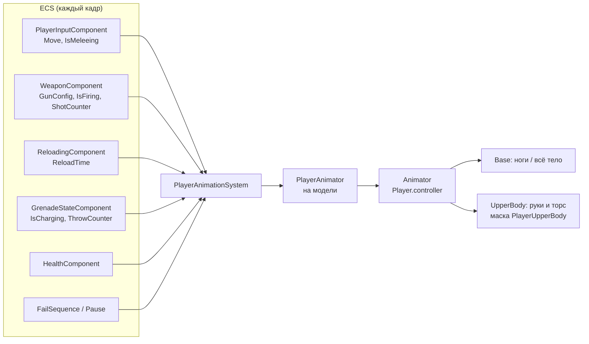
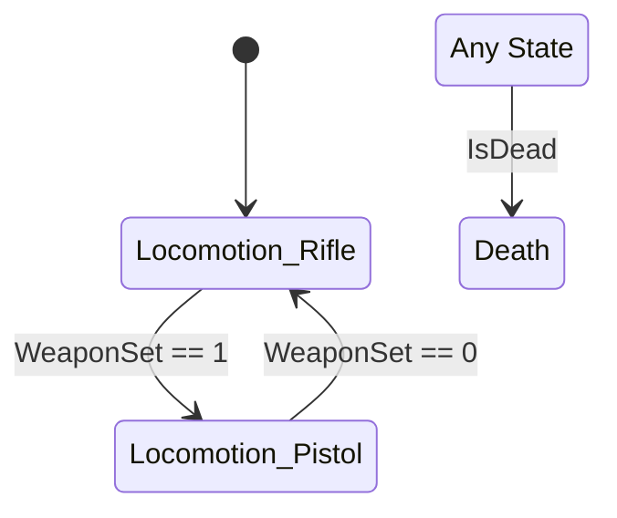
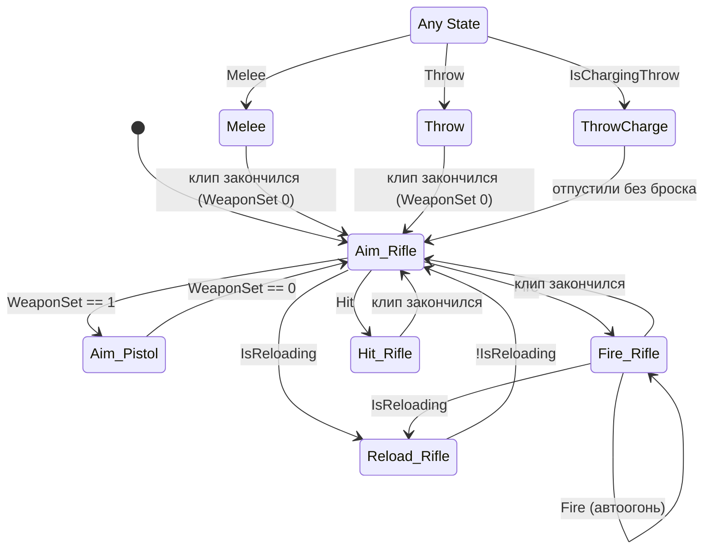
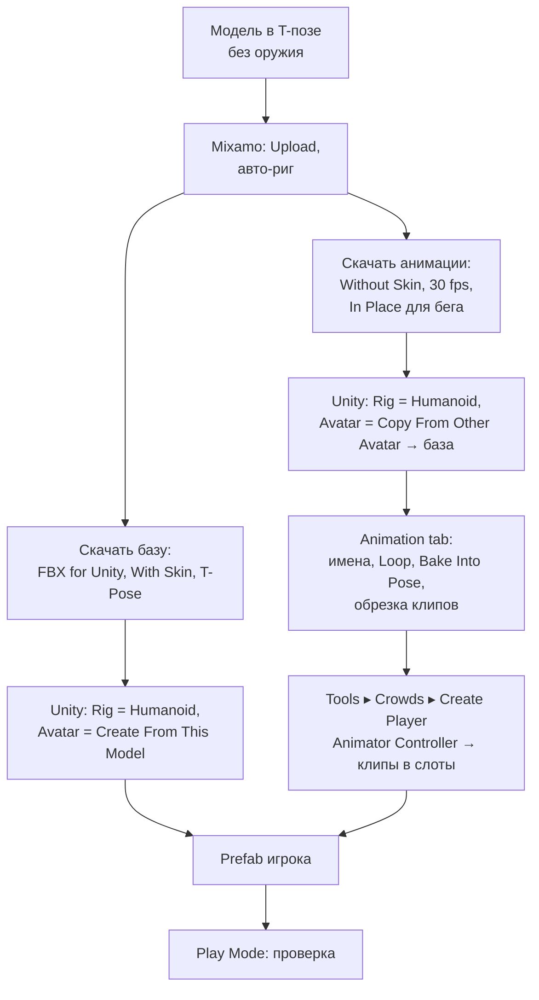

# Анимация игрока — инструкция

Игрок анимируется как Gunner: обычный скин + Animator, без запекания в VAT. Отличие от мобов — игрок бежит в любую сторону, но смотрит на курсор. Поэтому нужен **стрейф** (бег вбок и спиной вперёд) и **отдельный слой для верхней части тела**: ноги бегут, руки целятся, стреляют, перезаряжают.

Наборы анимаций: **Pistol** (только пистолет) и **Rifle** (всё остальное оружие). Набор задаётся полем `Animation set` в `GunConfig`.

| Оружие (`GunConfig`) | Набор | Модель (`GunConfig.Model`) | Перезарядка |
| --- | --- | --- | --- |
| Pistol | **Pistol** | `Pistol` | 1 с, магазин в рукоятке (не прячется) |
| Rifle | Rifle | `Mini14` (общая с зомби-стрелком) | 2 с, короткий магазин прячется |
| AR | Rifle | `AR` | 2 с, магазин прячется |
| SMG | Rifle | `SMG` | 1 с, магазин прячется |
| Shotgun | Rifle | `Shotgun` | **поштучно**, 0.5 с на патрон (`SingleLoad`) |
| SawedOff | Rifle | `SawedOff` | 1 с |
| MachineGun | Rifle | `MachineGun` | 4 с, короб с лентой прячется |

Модели оружия описаны в `Docs/WeaponModels.md`.

## Коротко: что скачать

В контроллере **28 слотов**: по 12 в наборах Rifle и Pistol (9 локомоции + Fire, Reload, Hit; Aim = тот же клип, что Idle) и 4 общих (Melee, ThrowCharge, Throw, Death). Скачивать меньше: правый стрейф — зеркало левого, ThrowCharge и Throw режутся из одного Grenade Throw. Подробно — в разделе «Какие анимации скачать».

**Минимум, чтобы запустить** (пустой слот просто не анимируется, игра работает):

1. Rifle Aiming Idle → Idle и Aim_Rifle.
2. Rifle Run (In Place) → Forward.
3. Rifle Run Backward (In Place) → Backward.
4. Rifle Strafe Left (In Place) → Left; Right — копия клипа с Mirror.
5. Firing Rifle → Fire_Rifle.
6. Reloading (rifle) → Reload_Rifle.
7. Dying → Death.

Дальше по приоритету: диагонали Rifle → набор Pistol → Hit → Melee → Grenade Throw.

## Как это устроено



`PlayerAnimationSystem` только читает состояние игры и выставляет параметры аниматора; на геймплей он не влияет. Если у игрока не назначен `PlayerAnimator`, система ничего не делает: игра работает и без модели.

### Действия игрока → параметры аниматора

| Действие в игре | Откуда берётся | Параметр | Анимация |
| --- | --- | --- | --- |
| Движение (WASD) | `Move` → в локальные оси игрока | `MoveX`, `MoveY`, `MoveSpeed` | стрейф-дерево, 9 клипов |
| Смена оружия | `GunConfig.AnimationSet`, `GunConfig.Model` | `WeaponSet` (0 Rifle, 1 Pistol) | переключение наборов + модель ствола в руке |
| Стрельба | каждый выстрел (`ShotCounter`) | `Fire` (trigger), `IsFiring` | Fire_X |
| Перезарядка | `ReloadTime > 0` | `IsReloading`, `ReloadSpeed` | Reload_X, растянута под `GunConfig.ReloadTime`; магазин модели скрыт |
| Удар (СКМ) | `IsMeleeing` | `Melee` (trigger) | Melee |
| Граната: зажатие | `IsCharging` | `IsChargingThrow` | ThrowCharge (цикл) |
| Граната: бросок | `ThrowCounter` | `Throw` (trigger) | Throw |
| Получение урона | прямое попадание: `HealthComponent.HitCounter` изменился (не чаще 0.5 с). Тики DoT (яд, `RequestDamageComponent.IsPeriodic`) не считаются | `Hit` (trigger) | Hit_X |
| Смерть | HP ≤ 0 или старт сцены смерти | `IsDead` | Death (верхний слой выключается) |
| Пауза | `PauseState.IsPaused` | `Animator.speed = 0` | замирание |

## Схемы контроллера

Контроллер генерируется кнопкой **Tools ▸ Crowds ▸ Create Player Animator Controller**. Получаются `Assets/_Animations/Player/Player.controller` и маска `PlayerUpperBody.mask`. Все состояния, переходы и слоты уже на месте — остаётся перетащить клипы.

### Слой Base (всё тело)



Каждое `Locomotion_*` — дерево **2D Freeform Directional** по `MoveX` / `MoveY`. Скорость воспроизведения = `MoveSpeed` (реальная скорость ÷ скорость клипа), чтобы ноги не скользили.

```
            MoveY
   ↖ Fwd-Left   ↑ Forward   ↗ Fwd-Right
   (-0.7, 0.7)  (0, 1)      (0.7, 0.7)

   ← Left       ● Idle      → Right        MoveX
   (-1, 0)      (0, 0)      (1, 0)

   ↙ Back-Left  ↓ Backward  ↘ Back-Right
   (-0.7,-0.7)  (0, -1)     (0.7,-0.7)
```

### Слой UpperBody (маска: торс, голова, руки)



Для пистолета — те же связи с суффиксом `_Pistol`. Melee, ThrowCharge и Throw — общие для обоих наборов. Из них игрок возвращается в Aim нужного набора по `WeaponSet`.

## Какие анимации скачать

Названия — это поисковые запросы на Mixamo, точные имена клипов могут отличаться. На Mixamo есть паки локомоции с оружием (запросы «rifle 8-way», «pistol»). Если они есть, скачивайте пак целиком: там все 8 направлений для одного стиля.

### Набор Rifle (все длинные стволы)

| Слот в контроллере | Запрос на Mixamo | Настройки |
| --- | --- | --- |
| Locomotion_Rifle → Idle | Rifle Aiming Idle | цикл |
| → Forward | Rifle Run | **In Place**, цикл |
| → Backward | Rifle Run Backward / Run Backwards | In Place, цикл |
| → Left / Right | Rifle Strafe Left / Right (или один, второй — Mirror) | In Place, цикл |
| → 4 диагонали | Rifle Run Forward Left/Right, Backward Left/Right | In Place, цикл |
| Aim_Rifle | Rifle Aiming Idle (тот же, что Idle) | цикл |
| Fire_Rifle | Firing Rifle (обрезать до одной отдачи, 0.1–0.2 с) | без цикла |
| Reload_Rifle | Reloading (rifle) | без цикла, длину записать в `PlayerAnimator` (про дробовик — ниже) |
| Hit_Rifle | Rifle Hit Reaction / Hit Reaction | без цикла |

### Набор Pistol

| Слот | Запрос на Mixamo | Настройки |
| --- | --- | --- |
| Locomotion_Pistol (9 слотов) | Pistol Idle, Pistol Run, Pistol Run Backward, Pistol Strafe (+Mirror), диагонали | In Place, цикл |
| Aim_Pistol | Pistol Idle / Pistol Aim | цикл |
| Fire_Pistol | Shooting (pistol), одна отдача | без цикла |
| Reload_Pistol | Pistol Reload | без цикла |
| Hit_Pistol | Pistol Hit Reaction / Hit Reaction | без цикла |

### Общие

| Слот | Запрос на Mixamo | Настройки |
| --- | --- | --- |
| Melee | Rifle Butt / Gun Butt / Punch | без цикла; момент удара ≈ 0.2 с (`MeleeConfig.Delay`) |
| ThrowCharge | первая половина Grenade Throw / Toss Grenade (замах) | цикл или «держать последний кадр» |
| Throw | вторая половина того же клипа (бросок) | без цикла |
| Death | Dying / Death From The Front | без цикла, `Loop Pose` выкл. |

Если для пистолета нет диагоналей, можно временно поставить в диагональные слоты прямые клипы (Forward или Backward). Дерево сгладит переход, просто будет менее точно.

### Особенности перезарядки

- **Один клип Reload_Rifle на все длинные стволы.** Он растягивается под `ReloadTime` конкретного оружия: у SMG (1 с) он идёт в 2 раза быстрее, чем у AR (2 с), у пулемёта (4 с) — в 2 раза медленнее. Берите клип со сменой магазина снизу. Магазин модели скрыт всю перезарядку, так что лучше клип, где рука не держит магазин у оружия в первом и последнем кадре.
- **Дробовик (`SingleLoad`)** заряжается по патрону: 0.5 с на патрон, и между патронами `IsReloading` на один кадр сбрасывается. Клип Reload_Rifle будет на каждый патрон начинаться заново в 4× ускорении и обрываться. Если это заметно — нужен отдельный набор `Shotgun` с коротким клипом «вставить патрон» или удержание `IsReloading` между патронами. Это код, сейчас не сделано.
- **Досылание затвора** (`ShutterTime` после перезарядки) отдельной анимации не имеет: в это время верх уже в Aim.

## Автоматический импорт (PlayerModelPipeline)

Ручные шаги 2–5 ниже делает инструмент. Порядок:

1. Скачанные клипы (Mixamo: *FBX for Unity, Without Skin, 30 fps*) разложите рядом с моделью по папкам `Rifle/`, `Pistol/`, `Common/` (Melee, Grenade Throw, Death). Слот определяется по словам в имени файла; учитываются **только** эти три папки (например, `Unsorted/` с паками целиком игнорируется). In Place не обязателен: горизонтальное смещение у локомоции, Idle/Aim/Fire/Reload/Hit отбрасывается (root motion не запекается, а Apply Root Motion выключен), у Death/Melee/Throw — остаётся в позе.
2. Выделите FBX модели (со скином) → ПКМ **Crowds ▸ Create Player Model Preset**. Появится `Assets/_Data/Player/<модель>_PlayerModelSetup.asset`, клипы будут разложены по слотам (кнопка **Scan Clips** — пересканировать).
3. Проверьте таблицу клипов в пресете (слот, файл, Mirror, Loop, обрезка From/To в секундах) и нажмите **Run Setup** (или Tools ▸ Crowds ▸ Run Selected Player Model Preset) при открытой `SampleScene`.
4. Сохраните сцену и проверьте в Play mode.

Что делает **Scan Clips**:

| Слова в имени файла | Слот |
| --- | --- |
| `reload` | Reload |
| `fire`, `firing`, `shoot` | Fire (обрезается до `FireClipLength`, 0.3 с) |
| `hit`, `reaction` | Hit |
| `idle` (с `aim` — приоритетнее) | Idle; Aim берёт тот же клип, если отдельного `aim` нет |
| `run`/`walk`/`strafe` + `forward`/`backward`/`left`/`right` | 9 слотов локомоции (`run` важнее `walk`) |
| `death`, `dying` | Death |
| `grenade`, `throw`, `toss` | ThrowCharge + Throw (делится по `ThrowSplit`) |
| `melee`, `butt`, `punch`, `kick`… | Melee |
| `turn`, `jump`, `crouch`, `sprint`… | пропускается |

Пробелы заполняются сами: правая сторона — зеркало левой (и наоборот), без диагоналей — прямой клип. ThrowCharge не зацикливается: состояние держит последний кадр (верх замаха). `ThrowSplit` по умолчанию 0.15 — под Mixamo «Toss Grenade» (бросок снизу: рука дальше всего назад на ~0.2 с из 1.4 с).

### Текущий набор: Survivor (`Assets/Model/Survivor`)

Отобран из скачанного по анализу FBX: длина, траектория бедра, положение кистей относительно груди (винтовка — кисти в ~20 см друг от друга, пистолет — ~10 см).

| Слот | Файл | Источник |
| --- | --- | --- |
| Rifle Idle / Aim | `Rifle/Rifle Aiming Idle` | одиночный |
| Rifle Forward | `Rifle/Rifle Run Forward` | одиночный «Rifle Run» (0.73 с) |
| Rifle Backward / Right | `Rifle/Rifle Run Backward`, `Rifle Run Right` | одиночные (In Place версии 8-Way) |
| Rifle Left, 4 диагонали | `Rifle/Rifle Run Left`, `…Forward Left/Right`, `…Backward Left/Right` | Rifle 8-Way pack (не In Place — смещение отбрасывается) |
| Rifle Fire | `Rifle/Rifle Fire` | Basic Shooter pack «firing rifle» (0.27 с) |
| Rifle Reload / Hit | `Rifle/Rifle Reload`, `Rifle Hit Reaction` | одиночные |
| Pistol Idle / Aim, Forward, Backward | `Pistol/Pistol Idle`, `Pistol Run Forward`, `Pistol Run Backward` | одиночные |
| Pistol Left / Right | `Pistol/Pistol Run Left` (= «Pistol Strafe»), `Pistol Run Right` (= «Pistol Strafe (1)») | одиночные; сторона определена по паковым версиям с движением |
| Pistol диагонали | — | прямой клип (у паков пистолета только дуги) |
| Melee | `Common/Melee Rifle Punch` | одиночный |
| ThrowCharge / Throw | `Common/Toss Grenade` (0–0.2 с / 0.2–1.4 с) | одиночный |
| Death | `Common/Death From Back Headshot` | одиночный |

**Нет на Mixamo (и в паках):** Pistol Fire, Pistol Reload, Pistol Hit. Пустой state в UpperBody сбросил бы руки в muscle-zero позу, поэтому Scan Clips (`FillActionGaps`) заполняет пробелы любого набора так:
- **Reload** ← перезарядка другого набора (для пистолета — `Rifle Reload`: на время перезарядки руки уходят в винтовочный хват; длина клипа берётся оттуда же).
- **Fire / Hit** ← кусок собственной Aim-позы (0.3 / 0.4 с, без движения), а движение даёт код: `PlayerAnimator` в `LateUpdate` поворачивает кости вокруг правой оси тела. Отдача (`_proceduralRecoilSets`) — плечи и кисти вверх, вздрагивание (`_proceduralFlinchSets`) — Spine/Chest назад. Оба списка Run Setup заполняет сам: набор попадает туда, если его Fire/Hit — тот же FBX и тот же From, что у Aim. Углы и длительности настраиваются в группе *Procedural kicks*. `PlayerAnimator` выполняется раньше `WeaponHandIK` (`DefaultExecutionOrder(-50)`).

Если позже найдётся настоящий клип, положите его в `Pistol/` и пересканируйте: stand-in заменится, процедурный эффект для набора отключится при следующем Run Setup.

Отсеяны (лежат в `Unsorted/`): «Crouch Strafe Run Left» (присед, бедро на ~10 % ниже остальных бегов), «Walking To Dying» (начинается с ходьбы), «Pistol Run Backward (1)» (точный дубль), «Rifle Idle» (не нужен: верх всегда в Aim), из паков — повороты, прыжки, присед, спринт, ходьба, дуговые пробежки пистолета, дубли одиночных клипов и копии `survivor_boy_5k.fbx`. Если одиночный «Rifle Run» плохо смешивается с диагоналями 8-Way (разная длина шага), поставьте в Forward `Unsorted/Rifle 8-Way Locomotion Pack/run forward.fbx` — та же серия, что диагонали.

Что делает **Run Setup**: текстуры и URP-материал; модель → Humanoid (аватар из модели); каждый клип → Humanoid, Copy From Other Avatar, root целиком Bake Into Pose, Loop/Mirror/обрезка; создаёт `Player.controller`, если его нет, и раскладывает клипы по слотам. Затем в открытой сцене пересобирает под `Player` дочерний объект `Body`: масштаб под `TargetHeight`, ступни на низ капсулы, Animator (контроллер, аватар, без root motion), `PlayerAnimator` (длины перезарядок, `_weaponBone`, стартовая поза оружия как у зомби-стрелка), `WeaponHandIK`, `Player._bodyAnimator`; рендереры `Capsule` и `Weapon` выключаются (коллайдер и `Muzzle` остаются). Повторный запуск сохраняет подогнанную позу оружия.

## Пайплайн Mixamo → Unity



### 1. Mixamo

1. **Upload Character** — модель в T-позе (FBX/OBJ), без оружия в руках (оружие — отдельные префабы, см. шаг 4.5). Расставьте маркеры (подбородок, запястья, локти, колени, пах).
2. Skeleton LOD: **Standard** (с пальцами) — игрок один, пальцы нужны для хвата оружия.
3. **База**: скачайте любую анимацию (или T-Pose) с настройками *FBX for Unity, With Skin*. Файл `Player.fbx`.
4. **Анимации**: *FBX for Unity, Without Skin, 30 fps*. Для бега и стрейфов включите **In Place** — движение задаёт код, root motion выключен. Имена файлов: `Player@Rifle Run.fbx`, `Player@Pistol Idle.fbx`… в `Assets/Model/Player/`.
5. Для стрейфа достаточно одной стороны — вторую получите галкой **Mirror** в Unity.

### 2. Импорт в Unity

**Важно: у игрока риг Humanoid, а не Generic, как у мобов.** Маска верхней части тела работает по гуманоидным костям, а ещё Humanoid позволяет зеркалить клипы.

- **База** `Player.fbx`:
  - Rig → Animation Type **Humanoid**, Avatar Definition **Create From This Model** → Configure… проверьте, что все кости зелёные.
  - Model → Scale Factor: рост персонажа ≈ 2 м.
  - Materials → Extract Materials → перевести на URP Lit.
- **Каждая анимация** `Player@*.fbx`:
  - Rig → **Humanoid**, Avatar Definition **Copy From Other Avatar** → аватар из `Player.fbx`.
  - Animation → переименуйте клип (Rifle_Run, Pistol_Reload…).
  - Loop Time — для бега, стрейфов, Idle/Aim, ThrowCharge. Для остальных выключено.
  - Root Transform Rotation / Position (Y) / Position (XZ) → **Bake Into Pose** у всех клипов.
  - Mirror — для второй стороны стрейфа (дублируйте клип через «+» в списке клипов).
  - Обрезка Start/End: Fire — одна отдача; Grenade Throw делится на два клипа (ThrowCharge до верхней точки замаха, Throw — от неё до конца).

### 3. Контроллер

1. **Tools ▸ Crowds ▸ Create Player Animator Controller**.
2. Откройте `Player.controller`.
   - В слое **Base** двойной клик по `Locomotion_Rifle` → 9 пустых слотов дерева. Порядок слотов: Idle, Forward, Backward, Left, Right, Fwd-Left, Fwd-Right, Back-Left, Back-Right. То же для `Locomotion_Pistol`.
   - В слое **UpperBody** выберите каждое состояние и задайте **Motion**. В состоянии `Death` (слой Base) — клип смерти.
3. Повторный запуск генератора **перезапишет** контроллер вместе с назначенными клипами. Сделайте копию, если меняете структуру.

### 4. Префаб игрока

```
Player                      ← Player, NavMeshAgent, LookAtCursor вращает этот объект
├── Weapon                  ← Weapon + Muzzle: ОСТАЁТСЯ на корне (не на кости!)
│   └── Muzzle
├── PlayerModel (Player.fbx)← Animator (Player.controller, аватар Player, Apply Root Motion выкл.)
│   │                          + PlayerAnimator
│   │                          (+ WeaponHandIK — левая рука на цевье, по желанию)
│   └── … mixamorig:RightHand  → PlayerAnimator._weaponBone
│       └── (модели оружия создаются в рантайме из GunConfig.Model)
└── (старая капсула — отключить рендерер или удалить)
```

1. Перетащите `Player.fbx` дочерним к `Player`.
2. На модель: **Animator** — Controller `Player.controller`, Avatar `PlayerAvatar`, **Apply Root Motion выкл.**, Culling Mode `Always Animate`.
3. Туда же **PlayerAnimator**. Укажите `_animator`, поля `_runClipSpeed` и длины клипов перезарядки (таблица ниже).
4. В компоненте **Player** на корне назначьте `_bodyAnimator` = этот `PlayerAnimator`.
5. **Оружие в руке.** Модели берутся из `GunConfig.Model` (их собирает **Tools ▸ Crowds ▸ Build Weapon Models**) и создаются под костью руки при первой смене на этот ствол.
   - `PlayerAnimator._weaponBone` = кость `mixamorig:RightHand`.
   - Поза: временно перетащите префаб `Mini14` дочерним к кости и в превью клипа Aim (Rifle Aiming Idle) поставьте его так, чтобы правая кисть лежала на шейке приклада, а ствол смотрел вперёд. Перепишите его поворот в `_weaponLocalEuler`, а позицию — **в метрах** (local position × масштаб кости) — в `_weaponLocalPosition`, и удалите временный объект. Проще: войдите в Play mode, подвигайте модель в руке, скопируйте значения и перенесите их в `PlayerAnimator`. Поза общая для всех стволов: у всех моделей корень = хват правой руки, ствол по +Z.
   - `_weaponScale` = 1 (масштаб кости, у Mixamo часто 0.01, компенсируется сам).
   - В стойке Pistol пистолету может понадобиться своя поза. Если он смотрит не туда — нужна вторая поза в `PlayerAnimator`, это небольшая доработка кода.
   - Старые `_rifleModel` / `_pistolModel` не нужны: модель из `GunConfig` их заменяет.
6. **Левая рука (по желанию).** Добавьте на модель `WeaponHandIK`: `_mob` пустой, `_animator` — этот Animator, `_stateLayer` = `UpperBody`, `_disabledStates` = `Reload_Rifle`, `Reload_Pistol`, `Melee`, `ThrowCharge`, `Throw` (в этих клипах левая рука занята) и `Death` (базовый слой проверяется всегда). Назначьте его в `PlayerAnimator._leftHandIK`. Тогда левая кисть стоит на точке `LeftHand` текущего ствола; у пистолета точки нет, и IK для него выключен. Без IK рука будет там, где её держит клип.
7. **Не переносите `Weapon` / `Muzzle` на кость руки.** Пули летят по `Muzzle.forward`: если дуло будет качаться вместе с анимацией, разброс станет зависеть от анимации. Дуло остаётся на корне, на высоте ствола; меш оружия в руке — только визуал.

### 5. Настройки PlayerAnimator

| Поле | Что это | Как подобрать |
| --- | --- | --- |
| `_runClipSpeed` | скорость (м/с), под которую снят бег | поставьте игрока бежать, крутите значение, пока ноги не перестанут скользить (обычно 3.5–6) |
| `_moveDamping` | сглаживание `MoveX/MoveY` | 0.1 с; больше — плавнее, но ленивее |
| `_rifleReloadClipLength` | длина клипа Reload_Rifle, с | из окна импорта клипа; анимация растягивается под `GunConfig.ReloadTime` |
| `_pistolReloadClipLength` | длина клипа Reload_Pistol, с | то же |
| `_weaponBone` | кость правой руки | `mixamorig:RightHand` |
| `_weaponLocalPosition` / `_weaponLocalEuler` | поза корня оружия в кости | один раз в позе Aim (шаг 5) |
| `_weaponScale` | мировой масштаб модели оружия | 1 |
| `_leftHandIK` | `WeaponHandIK` на теле | по желанию (шаг 6) |
| `_rifleModel` / `_pistolModel` | старые меши в руке | не нужны, если у `GunConfig` есть `Model` |

### 6. Проверка в Play Mode

- Бег во все 8 сторон при прицеливании в разные стороны: ноги идут в нужную сторону, верх целится в курсор.
- Подбор пистолета ↔ автомата переключает позу, бег и модель в руке.
- При перезарядке AR/SMG/Rifle/пулемёта магазин исчезает и возвращается в конце.
- Автоогонь даёт отдачу на каждый выстрел. Перезарядка заканчивается вместе с полоской перезарядки (у дробовика — поштучная).
- СКМ — удар. G или ПКМ (зажать) — замах, отпустить — бросок.
- Получение урона — вздрагивание (не чаще 0.5 с). Смерть — анимация доигрывает, хотя через секунду включается пауза.
- Пауза — персонаж замирает.

## Код

| Файл | Роль |
| --- | --- |
| `_Scripts/Enums/WeaponAnimationSet.cs` | `Rifle`, `Pistol` |
| `_Scripts/SO/GunConfig.cs` | поле `Animation set` (у `PistolConfig` = Pistol) |
| `_Scripts/Animation/PlayerAnimator.cs` | обёртка над Animator: имена параметров, null-safe (нет параметра — пропуск), скрытие верхнего слоя при смерти, пауза; `SetWeapon(GunConfig)` — модель ствола в руке, скрытие магазина при перезарядке |
| `_Scripts/Animation/WeaponHandIK.cs` | двухкостный IK левой руки на `WeaponModel.LeftHandTarget` |
| `_Scripts/WeaponModel.cs`, `_Scripts/Editor/Weapons/WeaponModelBuilder.cs` | модели оружия, см. `Docs/WeaponModels.md` |
| `_Scripts/ECS/PlayerAnimationSystem.cs` | чтение ECS → `PlayerAnimator`; регистрируется после `PlayerMovementSystem` |
| `_Scripts/Editor/PlayerAnimation/PlayerAnimatorControllerBuilder.cs` | генератор контроллера и маски |
| `WeaponComponent.ShotCounter`, `GrenadeStateComponent.ThrowCounter` | счётчики событий (+1 за выстрел / бросок) |

Новый набор анимаций (например, Shotgun): добавьте член в `WeaponAnimationSet`, строку в `Sets` генератора, длину перезарядки в `PlayerAnimator` и выставьте набор в нужных `GunConfig`.

## Ствол всегда по прицелу

Бег качает руки, а с ними и оружие в руке: ствол «гулял» относительно линии стрельбы (пули летят из `Weapon.Muzzle` по направлению взгляда игрока). Поэтому `PlayerAnimator` в `LateUpdate` после анимации и процедурной отдачи доворачивает кость `_weaponBone` (правая кисть) так, чтобы модель оружия смотрела ровно вперёд по телу (= на курсор) и стояла верхом вверх. Отдача добавляется поверх. Левая рука (`WeaponHandIK`, выполняется позже) следует за цевьём. Группа *Barrel aim*: `_aimBarrel` (вкл/выкл), `_freeBarrelStates` — состояния, где ствол не фиксируется (Reload_*, Melee, ThrowCharge, Throw, Death), `_aimBlendSpeed` — скорость перехода.
